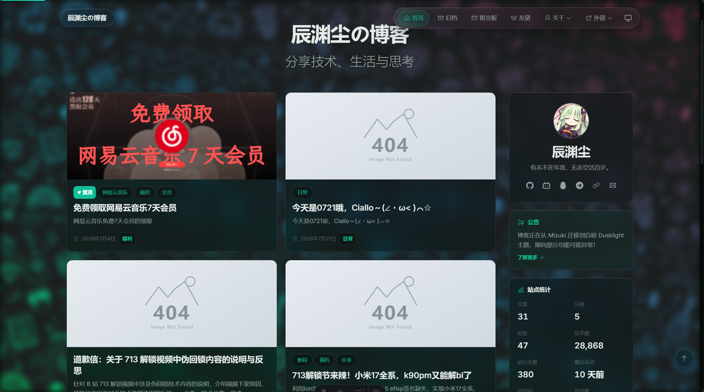
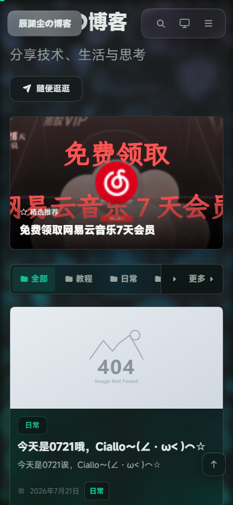

<div align="center">

# Dusklight

一款基于 Astro 的现代个人博客主题。

以高饱和磨砂玻璃质感、苹果几何大圆角、内容阅读体验与渐进增强为核心，在纯静态输出中组合 Svelte 交互岛、全文搜索、Twikoo 评论与丰富的 Markdown 能力。

[在线演示](https://blog.mcxiaochen.top/) · [使用指南](#快速开始) · [问题反馈](https://github.com/mcxiaochenn/Dusklight/issues)

[](https://github.com/mcxiaochenn/Dusklight/releases/latest)
[](https://github.com/mcxiaochenn/Dusklight/actions/workflows/deploy.yml)
[](https://astro.build/)
[](LICENSE)

</div>

## 预览

<table>
  <tr>
    <th width="72%">桌面端</th>
    <th width="28%">移动端</th>
  </tr>
  <tr>
    <td valign="top"></td>
    <td valign="top"></td>
  </tr>
</table>

## 亮点

- **玻璃视觉与超大 R 角**：采用高饱和度分层磨砂玻璃体系（`saturate(180%)` + `8px/16px/20px` 景深模糊、深色 `#1e1e1e99` 炭灰表面与 `#42444a` 细边框），全站统一 `1280px` 版心与苹果美学几何大圆角（`10px / 14px / 22px / 28px`）。
- **首页与阅读页重构**：首页顶部采用全宽双栏 `#home-top`（左栏标语、`-30deg` 斜向滚动技能墙、悬停「随便逛逛」与动态伸展渐变分类卡；右栏精选文章轮播）；文章阅读页采用独立全宽毛玻璃头卡与渐变标题、渐隐封面图，并与首页共用侧边栏（公告下方插入粘性 `TOC`，随全文结束自动释放）。
- **访客感知与倒计时统计**：侧边栏整合 Mo 风格多行公告（含访客定位、至站长距离、模糊 IP 与时段问候），以及「春节倒计时 + 今日/本周/本月/本年进度条」与站点统计合并卡片。
- **个性关于页与前端调试面板**：关于页集成双排无限滚动技能墙、生涯时间轴、访问统计暗角数据板与双主题矢量地图+三列信息栏；在 `/about/` 连点 5 下头像即可唤醒内建前端调试面板（支持跨页持久实时 **FPS 帧率浮窗 HUD**、毛玻璃透视描边、版心标尺与缓存清理）。
- **丝滑页面动效**：View Transitions 换页位移缩放弹簧过渡、页内锚点跳转呼吸高光与卡片微缩放反馈。
- **三档主题**：支持浅色、深色与跟随系统，内置明暗独立背景图与平滑切换动画。
- **内容体验**：Astro Content Collections、MDX、数学公式、Mermaid、图片网格、提示块与 Expressive Code。
- **全文搜索**：Pagefind Extended 构建中文静态索引，Svelte 搜索面板支持键盘导航与 `Ctrl/Cmd + K`。
- **站点服务**：RSS、Atom、Sitemap、结构化数据、Umami 统计、Twikoo 评论、朋友圈与友链状态检测。

## 技术栈

| 分类 | 方案 |
| --- | --- |
| 框架 | Astro 7、TypeScript、Svelte 5 |
| 样式 | 原生 CSS Token、Tailwind CSS 4 Utilities |
| 内容 | Astro Content Collections、Markdown、MDX |
| 搜索 | Pagefind Extended |
| 图标 | Font Awesome 7、Simple Icons、Iconify |
| 字体 | 寒蝉全圆体（中文网字计划）、Maple Mono CN、KaTeX 字体 |
| 评论 | Twikoo 2.0.18 |
| 部署 | GitHub Actions、GitHub Pages / EdgeOne Pages |

## 快速开始

### 环境要求

- Node.js 22.12.0 或更高版本
- pnpm 9

### 本地运行

```bash
git clone https://github.com/mcxiaochenn/Dusklight.git
cd Dusklight
pnpm install
pnpm dev
```

打开 `http://localhost:4321/` 即可使用仓库内置的演示内容预览站点。

### 构建

```bash
pnpm build
pnpm preview
```

生产构建会依次同步内容、更新追番数据、生成 Astro 静态站点和 Pagefind 中文索引，执行链接审计与首屏资源检查，最终产物位于 `dist/`。

## 配置

站点配置集中在 `src/config/`：

| 文件 | 用途 |
| --- | --- |
| `site.ts` | 站点信息、URL、全站推荐 `featuredSlugs`、首页顶端标语与分类卡、功能开关 |
| `profile.ts` | 个人资料、头像、社交链接、地图配置与 About 内容 |
| `announcement.ts` | 侧边栏公告文案、键盘提示、访客欢迎框坐标与诗句 |
| `nav.ts` | 顶部导航与下拉菜单 |
| `comment.ts` | Twikoo 评论与最近评论配置 |
| `seo.ts` | SEO 默认信息与搜索引擎验证 |
| `resources.ts` | 运行时第三方脚本与中文网字计划 CDN 样式入口 |
| `theme.ts` | 参考说明（真实设计令牌已统一收敛至 `src/styles/tokens.css`） |

主要视觉变量位于 `src/styles/tokens.css`。修改强调色、表面层级、间距、字号和圆角 Token，即可统一调整全站视觉。

首页推荐文章的宽幅图片尺寸、构图与压缩要求见 [首页推荐图规范](docs/HERO-IMAGES.md)。

## 使用独立内容仓库

Dusklight 支持将文章保存在独立仓库中，使主题代码与个人内容分离。复制环境变量模板并填写内容仓库配置：

```bash
cp .env.example .env
```

```dotenv
ENABLE_CONTENT_SYNC=true
CONTENT_REPO_URL=https://github.com/your-name/your-content-repository.git
CONTENT_BRANCH=main
```

未启用同步时，开发与构建流程会继续使用 `src/content/` 中的演示内容。私有仓库可在 CI 中通过具备读取权限的凭据访问，请勿将 Token 提交到版本库。

## 部署

仓库已提供 GitHub Actions 工作流：推送到 `main` 后安装依赖、同步内容、构建站点并发布到 `gh-pages` 分支。当前演示站由 EdgeOne Pages 读取该分支部署。

使用私有内容仓库时，需要在仓库 Secrets 中配置 `CONTENT_REPO_URL`；如需构建期同步 Bilibili 追番数据，可选配置 `BILI_SESSDATA`。

## 项目结构

```text
src/
├── components/     # Astro 组件与 Svelte 交互岛
├── config/         # 站点、公告、导航、资源、评论与个人配置
├── content/        # 内置演示内容
├── data/           # 友链、设备、技能、赞助等结构化数据
├── layouts/        # 基础页面与文章布局
├── pages/          # 页面、动态路由与静态 JSON Endpoint
├── plugins/        # Markdown / MDX 渲染插件
├── styles/         # Token、字体、玻璃材质、动效与全局样式
└── utils/          # 外链、加密、文章历史与评论路径工具
```

## 常用页面

| 路径 | 内容 |
| --- | --- |
| `/` | 首页 `#home-top` 双栏、文章流与侧边栏 |
| `/posts/<slug>/` | 文章独立英雄头卡、正文、目录、分享、许可与评论 |
| `/categories/`、`/tags/` | 分类与标签索引（外层 `.page-surface` 遮罩） |
| `/archive/` | 文章归档 |
| `/about/` | 关于页面（动态技能墙、地图/信息栏、统计板、连点 5 下头像调试面板） |
| `/link/` | 友链、状态检测与朋友圈摘要 |
| `/anime/` | 追番页面 |
| `/devices/`、`/skills/` | 设备清单与技术栈 |
| `/timeline/` | 项目开发时间线 |
| `/rss.xml`、`/atom.xml` | RSS 与 Atom 订阅 |

## 致谢与许可

字体与第三方资源的来源、版本和许可信息见 [NOTICE.md](NOTICE.md)。

Dusklight 使用 [MIT License](LICENSE) 开源。使用本项目时，请同时遵守内容、字体、图片及所接入第三方服务各自的许可与使用条款。
